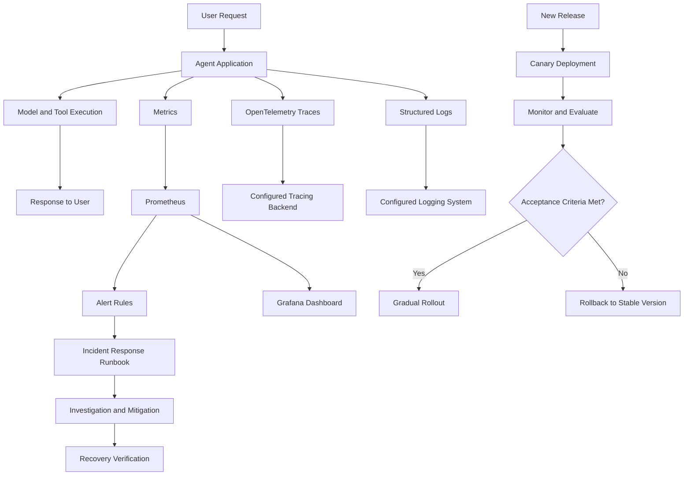

# Production Operations Architecture for an Agentic AI System

## 1. Architecture Overview

The architecture describes how an agentic AI system is monitored, how operational issues are detected, and how incidents and releases are managed safely.

## 2. Architecture Diagram

## 3. Component Responsibilities

- **Agent Application:** Processes requests and coordinates model and tool execution.
- **Metrics:** Measures request volume, error rates, latency, tool failures, and model usage.
- **OpenTelemetry:** Instruments application workflows for distributed tracing.
- **Structured Logs:** Provide diagnostic information for incident investigations.
- **Prometheus:** Collects metrics and evaluates configured alert rules.
- **Grafana:** Displays dashboards using configured data sources.
- **Tracing Backend:** Stores and provides access to traces when configured.
- **Logging System:** Stores and supports searching operational logs when configured.
- **Incident Response Runbook:** Guides investigation, mitigation, recovery, and communication.
- **Canary Deployment:** Introduces changes gradually and supports rollback when acceptance criteria fail.

## 4. Operational Workflow

1. The agent receives and processes a user request.
2. The application emits metrics, traces, and operational logs.
3. Prometheus evaluates metrics against configured alert rules.
4. Operators use dashboards and available telemetry to investigate abnormal behavior.
5. The incident response procedure guides mitigation and recovery verification.
6. New releases are evaluated through a controlled canary process before wider rollout.

## 5. Architecture Limitations

This diagram represents a proposed operational architecture. Actual traffic routing, centralized trace storage, log aggregation, and automated rollback require supporting infrastructure and configuration. They should not be considered implemented solely because they appear in this diagram.